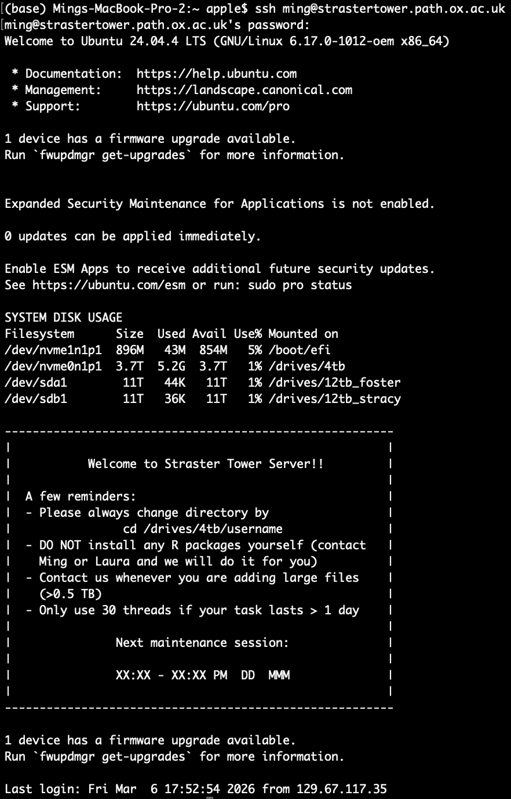
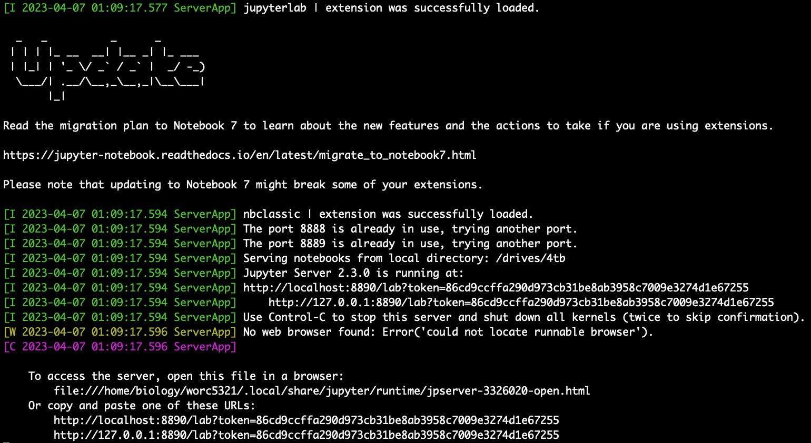
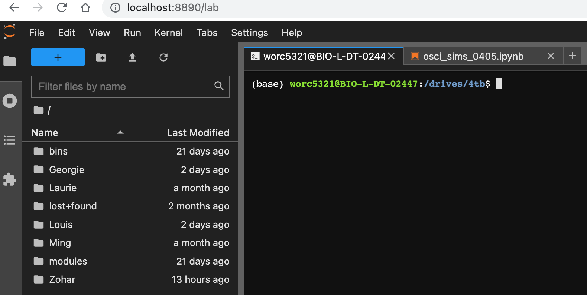
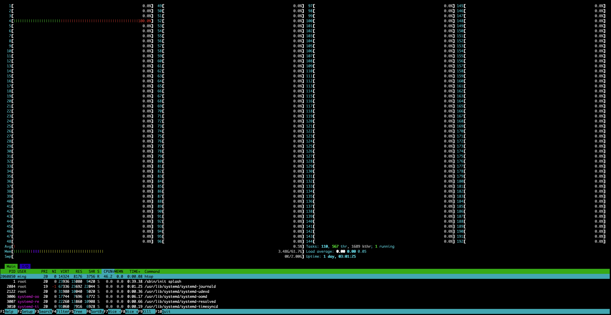
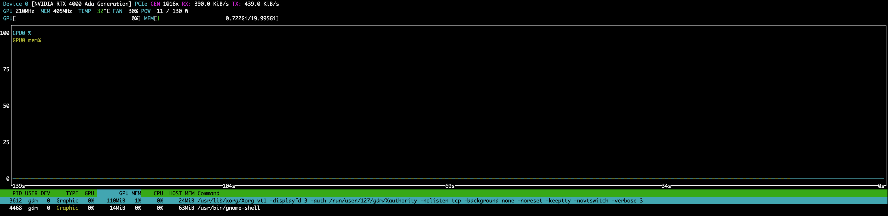
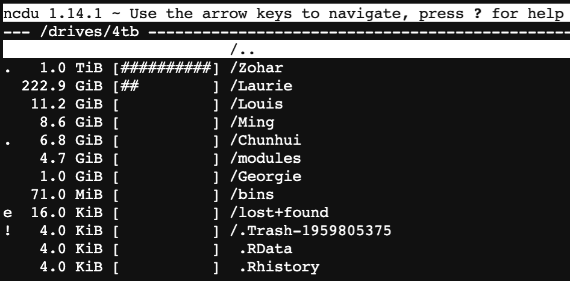
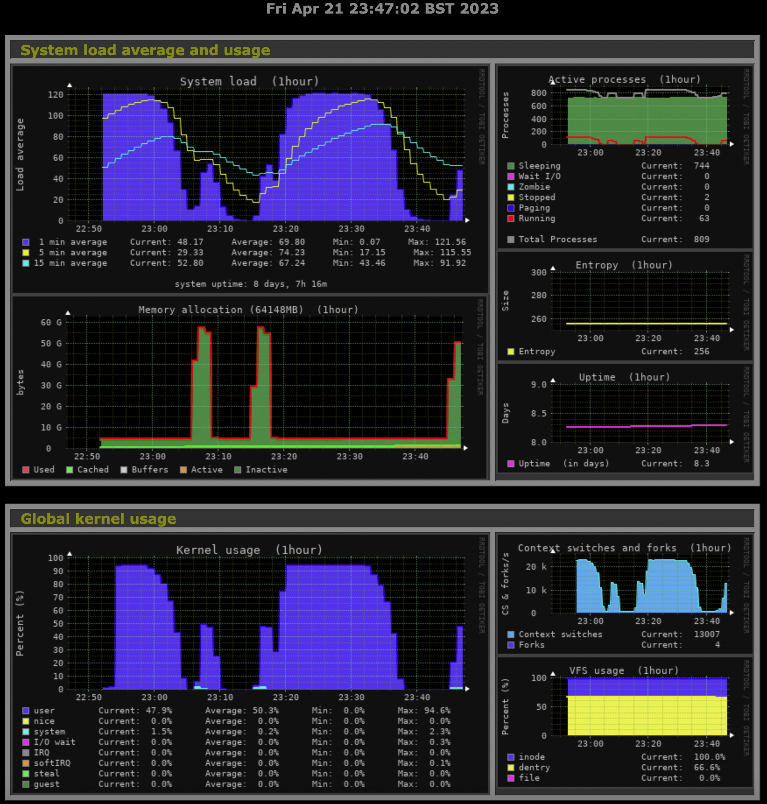
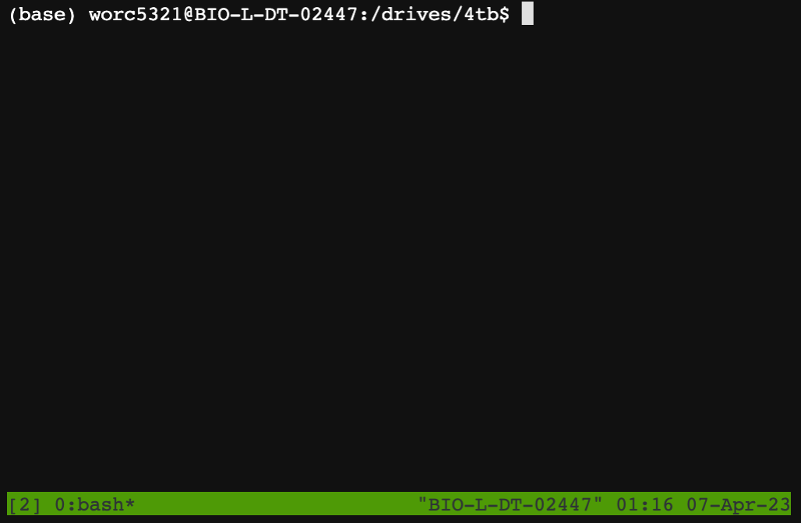
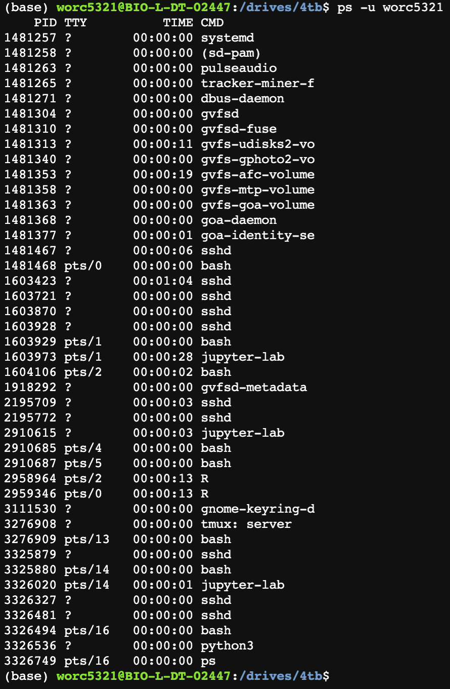
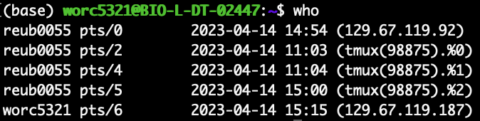

# StrasterTower User Manual

| Field | Details |
|---|---|
| Author | Ming Liu|
| Last updated | 28 Oct 2026 |
| Version | 2.1.1 |
| Scope | User guide for accessing and using StrasterTower |

---
<br><br>

## Table of contents

- [1. About the Straster Tower](#1-about-the-straster-tower)
  - [1.1 Drive structure and intended use](#11-drive-structure-and-intended-use)
  - [1.2 The relationships between machines](#12-the-relationships-between-machines)

- [2. Initialisation](#2-initialisation)
  - [2.1 Get started](#21-get-started)
    - [2.1.1 Configure your account](#211-configure-your-account)
    - [2.1.2 Connect to the server](#212-connect-to-the-server)
    - [2.1.3 Move to your personal folder](#213-move-to-your-personal-folder)

- [3. Install essential applications](#3-install-essential-applications)
  - [3.1 Install Miniconda/Miniforge](#31-install-minicondaminiforge)
  - [3.2 Install JupyterLab](#32-install-jupyterlab)

- [4. Useful commands and tools](#4-useful-commands-and-tools)
  - [4.1 Testing JupyterLab](#41-testing-jupyterlab)
  - [4.2 Basic linux commands](#42-basic-linux-commands)
  - [4.3 Monitoring the server](#43-monitoring-the-server)
    - [4.3.1 Monitoring computational load (htop and top)](#431-monitoring-computational-load-htop-and-top)
    - [4.3.2 Monitoring GPU](#432-monitoring-gpu)
    - [4.3.3 Monitoring disc space](#433-monitoring-disc-space)
    - [4.3.4 Check server activity history](#434-check-server-activity-history)
  - [4.4 Job management](#44-job-management)
    - [4.4.1 Choosing how to run a job](#441-choosing-how-to-run-a-job)
    - [4.4.2 Keep sessions running with tmux](#442-keep-sessions-running-with-tmux)
    - [4.4.3 Check processes and connections](#443-check-processes-and-connections)
    - [4.4.4 Run a computation with srun (optionally inside tmux)](#444-run-a-computation-with-srun-optionally-inside-tmux)
    - [4.4.5 Monitor and cancel Slurm jobs](#445-monitor-and-cancel-slurm-jobs)
    - [4.4.6 Submit unattended jobs with sbatch](#446-submit-unattended-jobs-with-sbatch)

- [5. Example code scripts](#5-example-code-scripts)
  - [5.1 Launch JupyterLab](#51-launch-jupyterlab)
  - [5.2 SSH connections for JupyterLab and Monitorix](#52-ssh-connections-for-jupyterlab-and-monitorix)
  - [5.3 Launch independent scripts in parallel with tmux](#53-launch-independent-scripts-in-parallel-with-tmux)
  - [5.4 Add resource management with srun](#54-add-resource-management-with-srun)
  - [5.5 Submit an unattended job with sbatch](#55-submit-an-unattended-job-with-sbatch)
---
# 1. About the Straster Tower
Our server was purchased under the ERC and Wellcome Trust fungings. Many thanks to Kevin, Mathew, and Laura for providing such a great computational resource! This document is intended to be a walk-through tutorial and toolbox. 

Some housekeeping notes to mention first:

- Always use __htop__ or top to check current traffic before launching heavy tasks.
- __Read the welcome message__ to check disk storage and scheduled maintenance session.
- This machine is a __computation device__, not for long-term storage. Please always assume data is at risk and save important files to your local device or an appropriate backup location.
- Feel free to work in your personal Python environment, but __do not__ install R packages system-wide yourself.

## 1.1 Drive structure and intended use
The server contains four drives:

- Two solid state drives (SSD)
  - One system drive (500 GB)
  - One 4 TB drive located at `/drives/4tb`
- Two hard disk drives (HDD)
  - One 12 TB drive located at `/drives/12tb_foster`
  - One 12 TB drive located at `/drives/12tb_stracy`

In general:

- Use __`/drives/4tb`__ for simulations, numerical work, and statistical analysis.
- Use __`/drives/12tb_foster`__ and __`/drives/12tb_stracy`__ mainly for metagenomic work.
- Your user account will be assigned to either the Foster or Stracy group during setup.

The folder layout is organised as follows:

- Personal work folder on the 4 TB drive: `/drives/4tb/$USER`
- Shared folder on the 4 TB drive: `/drives/4tb/shared`
- Personal work folder on the relevant 12 TB drive:
  - `/drives/12tb_foster/$USER` or
  - `/drives/12tb_stracy/$USER`
- Shared group folder on the relevant 12 TB drive:
  - `/drives/12tb_foster/shared` or
  - `/drives/12tb_stracy/shared`

## 1.2 The relationships between machines

**Server structure.** StrasterTower acts as the main access and processing point. Users usually use **SSH** to log on to StrasterTower from their personal computers, manage or process data there, and use it to interact with the shared Foster & Stracy storage server. New images from the microscope computer are stored on the storage server, while raw and processed images can also be exchanged with the image analysis computer.

# 2. Initialisation
## 2.1 Get started
### 2.1.1 Configure your account
Please find Ming or Laura to set up an account.

During setup, we will:

- create your user account,
- assign you to the appropriate group (`foster` or `stracy`),
- create your personal folders on the relevant drives.

### 2.1.2 Connect to the server
Once you __activate the Oxford VPN__, you can access the server via:
```bash
ssh $USER@strastertower.path.ox.ac.uk
```
Replace `$USER` with your username. After typing the password, you should be in the server.

### 2.1.3 Move to your personal folder
After logging in, you should usually move to your personal folder on the 4 TB drive:
```bash
cd /drives/4tb/$USER
```
__PLEASE ALWAYS REMEMBER__ to move to your intended working directory whenever you log on to the server.

# 3. Install essential applications
## 3.1 Install Miniconda/Miniforge
We recommend installing Miniconda inside your personal folder on the 4 TB drive. You will manage your own environment so there will be

```bash
# Go to your personal folder on the 4 TB drive
cd /drives/4tb/$USER

# Download Miniconda installer
wget https://repo.anaconda.com/miniconda/Miniconda3-latest-Linux-x86_64.sh -O miniconda.sh

# Install Miniconda into your personal folder
bash miniconda.sh -b -p /drives/4tb/$USER/miniconda3

# Remove installer
rm miniconda.sh

# Activate Conda for this shell
source /drives/4tb/$USER/miniconda3/bin/activate

# Set up Conda for future bash sessions
conda init bash

# Reload shell configuration
source ~/.bashrc

# Check installation
conda --version
```

__Important__: do __not__ manually create the `miniconda3` folder before running the installer.

See [here](https://conda.io/projects/conda/en/latest/user-guide/tasks/manage-environments.html) for more information about managing conda environments.

## 3.2 Install JupyterLab
Assuming you are already inside the correct conda environment, you can install JupyterLab with:
```bash
conda install -c conda-forge jupyterlab -y
```

You can confirm that it was installed correctly with:
```bash
jupyter lab --version
```
# 4. Useful commands and tools

## 4.1 Testing JupyterLab
The following commands show how to activate JupyterLab, assuming you start from a fresh terminal tab.

```bash
# Connect to the server
ssh $USER@strastertower.path.ox.ac.uk

# Move to your intended working directory before launching JupyterLab
cd /drives/4tb/$USER

# Launch JupyterLab on your preferred port
# Please choose a favourite port between 8800 and 8900, and keep using it consistently
jupyter lab --port=8888
```

If activation is successful, you should see URLs printed in the terminal. We will use the generated token to connect through the browser.

<p align="center">
  
</p>

**Successful SSH login to StrasterTower.** After connecting with `ssh username@strastertower.path.ox.ac.uk`, users should see the Ubuntu login message, current disk-usage summary, and the StrasterTower welcome/reminder box. This confirms that the SSH connection has reached StrasterTower successfully.

<p align="center">
  
</p>

**Jupyter server startup message.** After starting Jupyter, the terminal should show that Jupyter Server is running and provide two browser URLs containing an access token. Both URLs shown near the bottom can be copied and pasted. To activate the link from your own computer, keep this Jupyter terminal session open and use another terminal tab to set up the connection; this will be explained in the next section.

__Open another terminal tab__ to create the connection to JupyterLab through the chosen port.

```bash
# Replace 8888 with your preferred port between 8800 and 8900
ssh -N -f -L 8888:localhost:8888 $USER@strastertower.path.ox.ac.uk
```

Now paste the URL shown by JupyterLab into your browser. It should look something like:

`http://localhost:8888/lab?token=...`

You can then:

1. run or edit files through the tabs inside JupyterLab,
2. drag files to the file browser on the left side to upload them,
3. download files by right-clicking them in the file browser.

`Folders` would need to be `zipped` before download.

<p align="center">
  
</p>

**JupyterLab opened successfully.** A successful connection opens JupyterLab in the local web browser at `localhost:8890/lab`. The file browser on the left shows the server directory, while the terminal or notebook panel on the right runs on StrasterTower, not on the user’s personal computer.

## 4.2 Basic linux commands
```bash
# Change directory
## Move to the upper-layer folder
cd ..
## Move to folder A in the current directory
cd A
# Check the content in the directory
ls
# Create a folder
mkdir foldername
# Move files or folders
mv source destination
# Copy files
cp source destination
# Remove files or folder
rm -r folder
# Zip files in terminal
zip -r newzipfile.zip folder
# Unzip to the current directory (where the zip file is in)
unzip zipfile.zip
```

## 4.3 Monitoring the server
### 4.3.1 Monitoring computational load (htop and top)

```bash
# Open htop, a server monitor
htop
# Quit htop
q
# Another tool that keeps the list in terminal after quitting
top
# Quit top
q
```
<p align="center">
  
</p>

**Checking server activity with `htop`.** The `htop` display shows current CPU, memory, swap, load average, uptime, and running processes on StrasterTower. It is useful for checking whether the server is busy before starting large jobs, and for identifying processes that are using substantial resources.

__Please Keep__ the CPU loading __BELOW 190__ to prevent the server from crashing (first number in *load average*). See [here](https://www.deonsworld.co.za/2012/12/20/understanding-and-using-htop-monitor-system-resources/) for some detailed explanation of htop.

### 4.3.2 Monitoring GPU

```bash
# Open nvtop, a server monitor
nvtop
# Quit nvtop
q
```

<p align="center">
  
</p>

**Checking GPU activity with `nvtop`.** The `nvtop` display shows live GPU utilisation, GPU memory use, temperature, fan speed, power use, and active GPU-related processes. In this example, the NVIDIA RTX 4000 Ada GPU is mostly idle, with only light memory use by the graphical desktop processes.

### 4.3.3 Monitoring disc space

```bash
# For general and simple overview
df -h
# For file management: activate ncdu
ncdu # It might take a while to scan all files
# Delete files+ yes
d
# Quit ncdu
q
```
<p align="center">
  
</p>

**Checking disk usage with `ncdu`.** The `ncdu` display shows how much storage each folder uses under `/drives/4tb`. Users can navigate with the arrow keys to identify large folders and manage their own files. This is useful for checking personal disk usage before adding large datasets or asking the server admin for help with storage cleanup.

### 4.3.4 Check server activity history

This one is a bit different, you need to open another local terminal tab and open the tool from browser.

```bash
# In your local terminal
ssh -N -f -L 8080:localhost:8080 $USER@strastertower.path.ox.ac.uk
# In your browser
localhost:8080/monitorix
```
<p align="center">
  
</p>

**Monitoring server activity with `Monitorix`.** `Monitorix` provides a browser-based summary of recent server activity, including system load, active processes, memory use, kernel usage, and other system-level metrics. It is useful for reviewing server behaviour over time, especially when diagnosing heavy workloads or checking whether a large job has caused sustained high load.

## 4.4 Job management

There are several ways to run programs on StrasterTower. **`tmux` keeps a terminal session available after an SSH disconnection; Slurm (`srun`) schedules commands with a requested allocation of computational resources.** You can use either tool independently or combine them. This section explains the tools; [Section 5](#5-example-code-scripts) provides complete scripts and parallel-processing examples.

### 4.4.1 Choosing how to run a job

| I want to... | Suggested approach |
|---|---|
| Browse files, edit code, or run a short, predictable command | Ordinary SSH terminal |
| Keep my terminal available after disconnecting | `tmux` |
| Run unfamiliar or demanding software with an explicit resource request | `srun` |
| Keep a resource-managed command running when I disconnect | `tmux` + `srun` |
| Submit a longer, unattended job | `sbatch` |

**Rule of thumb:** Prefer `srun` for exploratory programs or third-party packages whose resource requirements are uncertain, even if you expect them to finish quickly. For simple, well-understood scripts, an ordinary terminal or tmux session may be sufficient.

### 4.4.2 Keep sessions running with tmux

`tmux` lets you create a terminal session that you can detach from and return to later. It is particularly useful for jobs that should continue after you disconnect from SSH.

```bash
# Start a named session
tmux new -s analysis

# Inside tmux, run your program as usual
python analysis.py

# When your work is finished, close the session
exit
```

If you need to disconnect **while your program is still running**, press **Ctrl+B, then D** to detach without interrupting the session. You can later reconnect via SSH and resume your work:

```bash
# List your sessions
tmux list-sessions

# Reattach to the named session
tmux attach -t analysis
```

After your work has finished, use `exit` inside tmux to close the session. Alternatively, from another terminal, you can close a particular session with `tmux kill-session -t analysis` (do not do this if it contains work you need to keep running).

<p align="center">
  
</p>

**tmux terminal session.** A session can be detached and reattached without restarting its programs.

**Detach vs exit:** Detaching preserves the session so that you can return to unfinished work; `exit` closes the current shell, and the tmux session normally ends when its last pane closes. **Use `exit` when finished and detach only when you need to disconnect before completion.** Please close completed sessions rather than leaving them inactive.

### 4.4.3 Check processes and connections

Use `ps` to inspect processes belonging to your account, including programs launched through tmux or Slurm. Use `who` to see logged-in terminal sessions.

```bash
# Show your processes and their elapsed time, CPU and memory use
ps -u "$USER" -o pid,etime,%cpu,%mem,cmd

# Show logged-in terminal sessions
who
```
<p align="center">
  
</p>

**Checking processes with `ps`.** Use this to identify programs running under your account.

<p align="center">
  
</p>

**Checking logins with `who`.** This lists terminal login sessions rather than every network connection. A tmux session is not an additional Linux user.

For a live view of computational load, see [`htop` in Section 4.3.1](#431-monitoring-computational-load-htop-and-top); for activity history, see [Monitorix in Section 4.3.4](#434-check-server-activity-history).

### 4.4.4 Run a computation with srun (optionally inside tmux)

Slurm schedules programs according to their requested resources. With `srun`, you can run familiar Python, R, or bioinformatics commands without modifying the underlying code.

```bash
# Example: run one Python program requesting two CPUs and 4 GB RAM
srun --ntasks=1 --cpus-per-task=2 --mem=4G python analysis.py
```

| Option | Meaning |
|---|---|
| `--ntasks=1` | Start one instance of the program |
| `--cpus-per-task=2` | Request two CPUs for that task |
| `--mem=4G` | Request 4 GB RAM for the job |

These values are **examples**, not fixed allocations for every user. If sufficient resources are not currently available, Slurm may wait before starting the command. Note that requesting multiple CPUs does not automatically make a single-threaded program parallel; where relevant, match your software's thread setting to the CPUs requested.

**Combining with tmux:** Start or reattach to a tmux session as described in 4.4.2, and run the `srun` command *inside* that session. You can detach while the command is running and reconnect later. This lets tmux handle terminal persistence while Slurm handles resource allocation. For a complete parallel-processing example using both tools, see [Section 5.4](#54-add-resource-management-with-srun).

For ordinary analyses, running individual commands with `srun` is usually simpler than keeping a Slurm interactive shell open. The latter is possible (for example, with `srun --pty bash`), but an allocation remains occupied while that shell is open, including idle periods. Please also see the [official `srun` documentation](https://slurm.schedmd.com/srun.html) for additional options.

### 4.4.5 Monitor and cancel Slurm jobs

Use `squeue` to inspect running or pending Slurm jobs, and `scancel` to stop a job you no longer need.

```bash
# Show your jobs
squeue -u "$USER"

# Show the status of one job (replace 12345 with its ID)
squeue -j 12345

# Cancel a job
scancel 12345
```

Common states include `PD` (pending), `R` (running), and `CG` (completing). Completed jobs disappear from `squeue`; disappearance does not necessarily indicate success. If Slurm accounting is available, you can check the outcome afterwards:

```bash
sacct -j 12345 --format=JobID,State,ExitCode
```

For scripts launched with ordinary Bash `&`, use `jobs`, `ps`, or `htop` instead: they do not appear in `squeue` unless launched through Slurm.

### 4.4.6 Submit unattended jobs with sbatch

`sbatch` is useful when a program should run independently of a terminal session. It submits a shell script to Slurm, which schedules the job and writes output to a log file. A batch job continues after your SSH connection closes.

```bash
# Submit a batch script containing #SBATCH directives
sbatch job.sh

# Then inspect the submitted job with squeue
```

A small, copyable batch example is in [Section 5.5](#55-submit-an-unattended-job-with-sbatch). For more detail, see the [official `sbatch` documentation](https://slurm.schedmd.com/sbatch.html).

# 5. Example code scripts

This section provides **complete command-line examples** for common tasks on StrasterTower. Sections 5.1-5.3 preserve familiar JupyterLab, SSH, tmux and parallel-script workflows. Section 5.4 shows how to add `srun` to similar computations, and 5.5 introduces unattended submission through `sbatch`.

The commands assume that you have connected to the server, selected the relevant working directory, and installed the software used in each example. Adapt filenames, folders and package environments to your own project.

## 5.1 Launch JupyterLab

The following commands run on **StrasterTower**, after you connect through SSH. Activate the Conda environment in which JupyterLab is installed.

```bash
# On StrasterTower
cd /drives/4tb/$USER

# Activate your environment if necessary
# conda activate your_environment

jupyter lab --no-browser --ip=127.0.0.1 --port=8888
```

The terminal will display a local URL containing an access token. Keep JupyterLab running, then follow [Section 5.2](#52-ssh-connections-for-jupyterlab-and-monitorix) to open it from your own computer. Stop JupyterLab with **Ctrl+C** when finished. For screenshots and more detail, see [Section 4.1](#41-testing-jupyterlab).

## 5.2 SSH connections for JupyterLab and Monitorix

Open a **new terminal on your own computer**, not on StrasterTower. Use SSH port forwarding to access services running on the server.

```bash
# JupyterLab tunnel (on your local computer)
ssh -N -L 8888:127.0.0.1:8888 $USER@strastertower.path.ox.ac.uk
```

If you also want to view Monitorix:

```bash
# Monitorix tunnel (on your local computer)
ssh -N -L 8080:127.0.0.1:8080 $USER@strastertower.path.ox.ac.uk
```

Replace `$USER` with your server username. In your local browser, open:

- **JupyterLab:** `http://localhost:8888/lab?token=...` (paste the token from the JupyterLab terminal)
- **Monitorix:** `http://localhost:8080/monitorix`

These SSH tunnels run in the foreground, so pressing **Ctrl+C** in their local terminal closes the relevant connection. You can alternatively use the background `ssh -N -f -L` method described in Section 4.1, but then close the particular SSH process when finished. Avoid killing every process associated with a port, since some may be unrelated. See [Section 4.3.4](#434-check-server-activity-history) for more about Monitorix.

## 5.3 Launch independent scripts in parallel with tmux

A simple way to run multiple independent programs is to open a tmux session and append `&` to each command. The `&` tells Bash to run that command in the background, allowing you to launch another one without opening a new terminal. It does **not** schedule the jobs or allocate resources; check the server load before starting several processes.

Start tmux in your working directory:

```bash
cd /drives/4tb/$USER

tmux new -s parallel
```

The following examples are **alternatives for different programming languages**; choose the one relevant to your project. They assume the indicated folders and code files already exist.

**C - Compile once and execute in separate folders**

```bash
# Compile in the directory containing code.c
gcc code.c -lm -O2 -o simulation

# Copy the executable to two experiment folders
for d in folder_1 folder_2; do cp simulation "$d/"; done

# Run both copies in the background, with separate logs
(cd folder_1 && ./simulation x=0 > run.log 2>&1) &
(cd folder_2 && ./simulation x=1 > run.log 2>&1) &
```

**Python - Run the same script with different arguments**

```bash
# Copy the script to each experiment folder
for d in folder_1 folder_2; do cp code.py "$d/"; done

# Run independent analyses in parallel
(cd folder_1 && python code.py a=0 b=0 > run.log 2>&1) &
(cd folder_2 && python code.py a=0 b=1 > run.log 2>&1) &
```

**R - Run several analysis scripts**

```bash
# From your folder containing the input data
cd folder_with_data

R CMD BATCH ../AnalysisCodes/Analysis1.R &
R CMD BATCH ../AnalysisCodes/Analysis2.R &
R CMD BATCH ../AnalysisCodes/Analysis3.R &
```

`R CMD BATCH` normally writes an `.Rout` file for each script. If your R code relies on the shared package library, retain the relevant `.libPaths()` setting used by your project (for example, `/drives/4tb/modules/R`).

**MATLAB - Run a script non-interactively**

```bash
# From the directory containing script.m
matlab -batch "script" > script.log 2>&1 &
```

To inspect and finish background work in **the same tmux shell**:

```bash
# List background jobs started from this shell
jobs -l

# Wait until all of these background jobs finish
wait
```

Use `jobs -l` to inspect background processes and `wait` to wait until they have finished. Check their output files to confirm that the analyses completed successfully. Then close the tmux session:

```bash
exit
```

If you need to disconnect **before** the jobs finish, detach with **Ctrl+B, then D** and reconnect later to check their progress.

For job status and server activity, you can also use `ps`, `htop`, and Monitorix ([Sections 4.4.3](#443-check-processes-and-connections) and [4.3](#43-monitoring-the-server)).

## 5.4 Add resource management with srun

You do not need to rewrite the examples in Section 5.3 to use Slurm. Instead, place `srun` and the resource request before the program you want to launch. The underlying Python, R, C or MATLAB code stays the same.

For example, inside an existing tmux session:

```bash
# One Python analysis, requesting two CPUs and 4 GB RAM
srun --ntasks=1 --cpus-per-task=2 --mem=4G python code.py a=0 b=0
```

You can also start **several independent `srun` commands** in the background. Slurm handles their scheduling instead of relying solely on your choice of how many processes to start at once:

```bash
# From the directory containing folder_1 and folder_2
(cd folder_1 && srun --ntasks=1 --cpus-per-task=2 --mem=4G python code.py a=0 b=0 > run.log 2>&1) &
(cd folder_2 && srun --ntasks=1 --cpus-per-task=2 --mem=4G python code.py a=0 b=1 > run.log 2>&1) &

# Wait for both submission commands to finish
wait
```

This is the same folder-based pattern as Section 5.3, now using an explicit resource request for each computation. The values are illustrative: choose appropriate CPU and RAM requests for your actual program. If a package has a threading option, keep its thread count consistent with the CPU request.

**A bioinformatics example.** If FastQC is installed in your environment, its thread setting can be combined with Slurm's CPU request:

```bash
srun --ntasks=1 --cpus-per-task=2 --mem=4G \
    fastqc --threads 2 reads_R1.fastq.gz reads_R2.fastq.gz
```

To make the workflow persistent, start tmux **before** launching these commands, and detach if you need to disconnect while the jobs are running. When you return, reattach using `tmux attach -t parallel`, inspect the output logs, and use `squeue -u "$USER"` to see jobs still being managed by Slurm. Once all computations have finished, use `exit` to close the tmux session. See [Section 4.4.4](#444-run-a-computation-with-srun-optionally-inside-tmux) for an explanation of the Slurm options.

## 5.5 Submit an unattended job with sbatch

For an analysis that should run independently of your terminal, create a small shell script called `job.sh`:

```bash
#!/bin/bash
#SBATCH --job-name=analysis
#SBATCH --ntasks=1
#SBATCH --cpus-per-task=2
#SBATCH --mem=4G
#SBATCH --output=analysis-%j.out

python analysis.py
```

Submit the script from your working directory:

```bash
sbatch job.sh
squeue -u "$USER"
```

Slurm returns a job ID and writes the program output to a file such as `analysis-12345.out`. You can disconnect from SSH after submission without stopping the batch job. For a larger collection of independent samples, Slurm also supports [job arrays](https://slurm.schedmd.com/job_array.html), but the tmux and `srun` examples above are sufficient for many everyday workflows.
